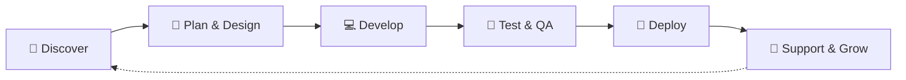

<!-- Header -->

  

  

  
  
  

---

## 👋 Welcome to Beacon Soft

**Beacon Soft Ltd** is a software development company crafting modern, scalable, and maintainable digital products. From robust **Laravel** back-ends and **NestJS** APIs to lightning-fast **React / Next.js** front-ends and custom **WordPress** solutions, we help businesses turn ideas into production-ready software.

<table>
  <tr>
    <td width="50%" valign="top">

### 🚀 What We Do

- 🌐 **Custom Web Applications** — end-to-end, from idea to deployment
- ⚙️ **API Development** — RESTful & GraphQL services with Laravel and NestJS
- ⚛️ **Modern Front-ends** — SPAs, SSR & static sites with React and Next.js
- 📝 **WordPress Solutions** — custom themes, plugins & WooCommerce stores
- 🛒 **E-commerce Platforms** — secure, high-converting online stores
- 🔧 **Maintenance & Support** — upgrades, performance tuning & audits

</td>
    <td width="50%" valign="top">

### 💡 How We Work

- ✅ **Clean Architecture** — readable, testable, maintainable code
- 🔒 **Security First** — best practices baked in from day one
- ⚡ **Performance Focused** — fast load times & optimized queries
- 🔄 **Agile Delivery** — short iterations & transparent progress
- 🤝 **Long-term Partnership** — we grow with our clients
- 📦 **Open Source Friendly** — we build on and give back to the community

</td>
  </tr>
</table>

---

## 🛠️ Our Tech Stack

  

  

<b>📋 View the full stack breakdown</b>

 

| Area | Technologies |
| :--- | :--- |
| **Back-end** |     |
| **Front-end** |       |
| **CMS & E-commerce** |    |
| **Databases** |     |
| **DevOps & Cloud** |      |
| **Tools** |      |

---

## 🧭 Our Process

---

## 🤝 Contributing

We love collaboration! Whether it's reporting a bug, suggesting a feature, or opening a pull request — every contribution is welcome.

1. Fork the repository
2. Create your feature branch: `git checkout -b feature/amazing-feature`
3. Commit your changes: `git commit -m "Add amazing feature"`
4. Push to the branch: `git push origin feature/amazing-feature`
5. Open a Pull Request 🎉

---

## 📫 Get in Touch

  
  
  
  

  <i>⭐ If you find our work useful, consider giving our repositories a star — it means a lot!</i>

<!-- Footer -->

  

